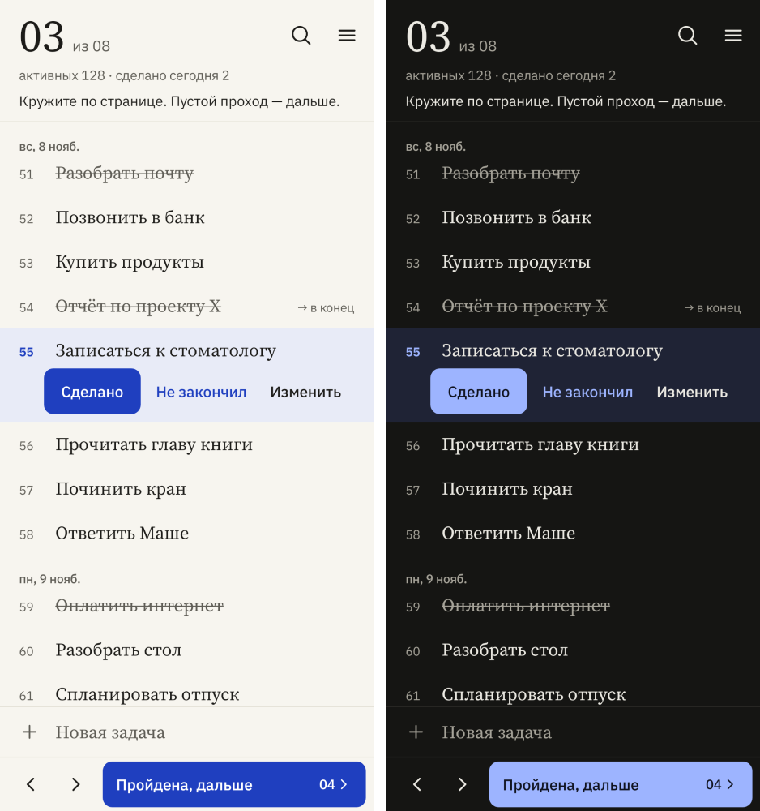
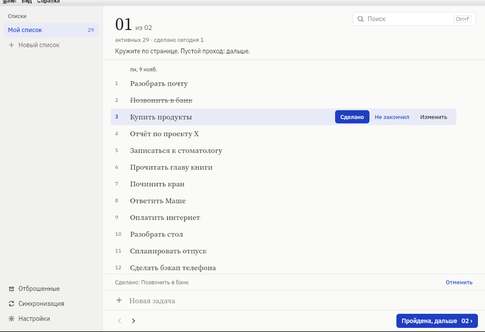

# Страница

Список дел, который читают по страницам. Всё записывается в конец одного длинного списка,
а задачу выбирают не по приоритетам, а по тому, что «выделилось» при чтении.
Android и компьютер (Windows, macOS, Linux). Без аккаунтов и без облака.

[](LICENSE)


*In English: a paper-style to-do list for Android and desktop based on Mark Forster's
Autofocus 1 method. No accounts, no cloud, direct encrypted sync between your devices.
The interface is in Russian and English.*





> Метод — Autofocus 1 Марка Форстера (Mark Forster). Приложение неофициальное
> и с автором метода не связано.

## Содержание

- [Как это работает](#как-это-работает)
- [Возможности](#возможности)
- [Установка](#установка)
- [Синхронизация](#синхронизация)
- [Данные и приватность](#данные-и-приватность)
- [Сборка из исходников](#сборка-из-исходников)
- [Устройство проекта](#устройство-проекта)
- [Участие в проекте](#участие-в-проекте)
- [Лицензия](#лицензия)

## Как это работает

1. Записывайте всё, что нужно сделать, по одной задаче в строку. Всегда в конец.
2. Список разбит на страницы (по умолчанию 25 строк, настраивается от 10 до 40).
   Сначала быстро прочитайте рабочую страницу.
3. Затем читайте медленно, пока какая-то задача не «выделится». Работайте над ней сколько хочется:
   - закончили: **Сделано**;
   - не закончили: **Не закончил**. Строка вычёркивается и переписывается в конец.
4. Кружите по странице, пока проход не перестанет давать задачи, затем **Дальше**.
5. Если при первом проходе ничего не выделилось, страница **отбрасывается** (кроме последней).
   Отброшенное можно просмотреть и вернуть в конец списка.

Порядок строк приложение не меняет и ничего не оценивает. Это часть метода.
Закрытые строки остаются в списке зачёркнутыми, чтобы не сдвигалась нумерация страниц и работала
отмена. Старые можно убрать в **Настройки → Очистка**.

## Возможности

- Несколько списков (например, «Дом» и «Работа»), у каждого свои страницы.
- Поиск по всем страницам и отмена последних действий.
- После перерыва от трёх дней приложение предлагает сначала прочитать все невыполненные задачи.
- **Android:** свайпы (вправо: сделано, влево: в конец), виджет на главный экран,
  «Поделиться → Страница», темы: светлая, тёмная, AMOLED, цвета обоев (Material You).
- **Компьютер:** управление с клавиатуры (F1 показывает список клавиш), боковая панель со списками.
- Английский и русский интерфейс по языку системы.
- Проверка обновлений через GitHub Releases (отключается в настройках).

## Установка

Готовые файлы лежат в разделе [Releases](../../releases):

| Система | Файл |
| --- | --- |
| Android 8.0+ | `.apk` |
| Windows | `.msi` или `.exe` |
| macOS | `.dmg` |
| Linux | `.deb` или `.rpm` |

- **Android:** когда телефон спросит, разрешите установку из этого источника.
- **Windows и macOS:** установщики не подписаны сертификатом разработчика, поэтому при первом
  запуске система предупредит. На macOS: правой кнопкой по приложению, затем «Открыть».

## Синхронизация

Данные хранятся только на ваших устройствах и синхронизируются напрямую, когда они в одной сети.

- **Первое знакомство:** по QR-коду или по шестизначному коду, который сверяется на обоих экранах.
- **Дальше автоматически:** в настройках выбирается интервал (5–60 минут). Компьютер, пока
  программа запущена, сам принимает знакомые устройства. Телефон синхронизируется при открытии
  и затем по интервалу, пока приложение на экране.
- **Защита:** канал зашифрован (Noise). Незнакомым устройствам программа отказывает.
- **Конфликты:** побеждает последнее изменение строки. Удаления тоже переносятся.

## Данные и приватность

Ни аккаунта, ни аналитики, ни рекламы. Единственный сетевой запрос в интернет — проверка
обновлений на GitHub (её можно выключить). Резервную копию можно сохранить в файл и восстановить
в настройках.

| Система | Где лежат данные |
| --- | --- |
| Android | внутренняя память приложения |
| Linux | `~/.local/share/stranitsa/` |
| macOS | `~/Library/Application Support/Stranitsa/` |
| Windows | `%APPDATA%\Stranitsa\` |

## Сборка из исходников

Нужны JDK 21 и Rust. Для Android ещё Android SDK (platform 35, NDK 27.2.12479018) и `cargo-ndk`.

```bash
(cd core && cargo test)                                   # тесты ядра
./gradlew testDebugUnitTest assembleRelease               # Android
cd desktop && ./gradlew run                               # компьютер: запустить
cd desktop && ./gradlew packageDistributionForCurrentOS   # установщик для этой системы
```

Установщик для компьютера собирается только на своей системе: `.msi` на Windows, `.dmg` на macOS.

### Выпуск версии

```bash
git tag v1.1.0 && git push --tags
```

Workflow `.github/workflows/release.yml` соберёт APK и установщики для трёх систем и опубликует
их в Releases. Для подписи APK в секретах репозитория нужны `ANDROID_KEYSTORE_BASE64`
(base64 от `keystore/release.jks`) и `ANDROID_KEYSTORE_PROPERTIES` (содержимое
`keystore/keystore.properties`). Без них соберётся неподписанный APK. Ключ в репозиторий
не кладётся.

Проверка обновлений не использует токен доступа к GitHub, поэтому работает только для
**публичного** репозитория. Для форка укажите свой при сборке: `-PupdateRepo=владелец/имя`.

## Устройство проекта

```
core/      общее ядро на Rust: правила метода, хранение, слияние копий, синхронизация
app/       Android: Jetpack Compose поверх ядра (привязки UniFFI)
desktop/   компьютер: Compose Multiplatform поверх того же ядра
design/    макеты интерфейса
docs/      картинки для README
licenses/  лицензии шрифтов
```

Правила метода и синхронизация написаны один раз в `core/` и покрыты тестами (`cargo test`).
Android и компьютер только рисуют интерфейс поверх ядра.

## Участие в проекте

Ошибки и пожелания — в [Issues](../../issues). Перед запросом на слияние запустите тесты ядра
и тесты платформы, которую меняли. Порядок строк в списке и оценка задач программой — вне
рамок метода, такие предложения не принимаются.

## Лицензия

[Apache License 2.0](LICENSE), см. также [NOTICE](NOTICE). Название «Страница» и логотип
лицензией не передаются: форкам лучше выбрать другое имя.

Шрифты Source Serif 4 и IBM Plex Sans распространяются по SIL Open Font License,
тексты лицензий лежат в [`licenses/`](licenses/).
